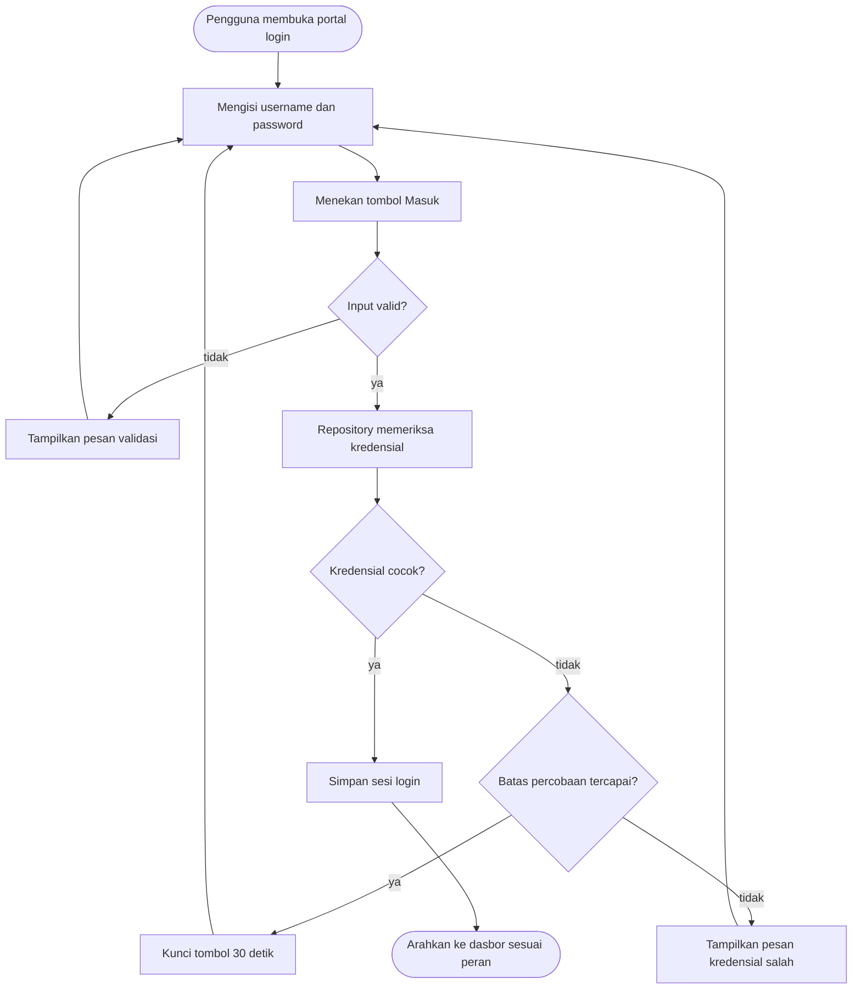

# Benerin Donk — Software Construction & Good Coding Practices

**Fitur terpilih: Otentikasi/Login (FR-10, UC-04, UC-08)**

| | |
|---|---|
| Mata kuliah | Rekayasa Perangkat Lunak |
| Dosen pengampu | Dr. Dewi Khairani, M.Sc. |
| Kelas | 3A+D TI 25, Program Studi Teknik Informatika, FST UIN Syarif Hidayatullah Jakarta |
| Proyek | Benerin Donk, layanan pelaporan kerusakan fasilitas FST berbasis web |
| Teknologi | HTML, CSS, JavaScript (tanpa framework); pengujian dengan Node.js |

| Anggota | NIM |
|---|---|
| Daffa Haqurrizqo Rabbany | 1251420091 |
| Naufal Fadhlan | 1251420023 |
| Ananda Ahmad Firjatullah | 1251420048 |
| Helmi Yahya Prasetyo (3D) | 1251420085 |

**Menjalankan proyek.** Buka `landing/landing.html`, lalu pilih Portal Admin atau Portal Pemimpin. Akun demo: `admin` / `admin123` dan `pemimpin` / `pemimpin123`. Menjalankan pengujian: `node tests/auth.test.js`.

---

## Tahap 1 — Identifikasi Fitur

### 1.1 Deskripsi FR-10

| Elemen | Isi |
|---|---|
| ID dan aktor | FR-10 · Admin dan Pemimpin |
| System behavior | Melakukan otentikasi (login) sesuai hak akses |
| Rumusan | Sistem melakukan otentikasi berdasarkan data username dan password sebelum memberikan akses masuk |
| Alasan | Menjaga keamanan data sistem internal dan membatasi akses operasional hanya kepada pihak yang berwenang |
| Kondisi awal | Pengguna berada di portal login aplikasi |
| Tindakan | Memasukkan kredensial yang valid ke dalam formulir, lalu menekan "Masuk" |
| Hasil yang diharapkan | Sistem menyetujui hak akses dan mengarahkan pengguna ke halaman dasbor sesuai peran (Admin atau Pemimpin) |

Pelapor tidak termasuk cakupan FR-10 karena mengakses sistem tanpa login (FR-01).

### 1.2 Keterkaitan dengan UC-04 dan UC-08

FR-10 diwujudkan oleh dua use case yang memiliki alur sama, tetapi berbeda pada aktor, portal, dan halaman tujuan.

| Aspek | UC-04 Login Admin | UC-08 Login Pemimpin |
|---|---|---|
| Aktor | Admin (Staf Sarpras FST) | Pemimpin (Kaprodi TI atau Dekanat) |
| Pemicu | Memilih Portal Admin di landing page | Memilih Portal Pemimpin di landing page |
| Prasyarat | Mengetahui satu username dan password portal admin | Mengetahui satu username dan password portal pemimpin |
| Kondisi akhir sukses | Masuk ke portal admin | Masuk ke portal pemimpin |
| Relasi | Di-include oleh UC-05, UC-06, UC-07 | Di-include oleh UC-09 |
| Halaman tujuan | `admin/dashboard.html` | `pemimpin/dashboard.html` |

Pemetaan alur alternatif pada dokumen use case ke implementasi:

| Alur | Kondisi (UC-04 / UC-08) | Penanganan pada kode |
|---|---|---|
| A1 | Username kosong | `validasiKredensial` mengembalikan `pesanError.usernameKosong`, kolom username ditandai |
| A2 (UC-04) / A3 (UC-08) | Password kosong | `validasiKredensial` mengembalikan `pesanError.passwordKosong`, kolom password ditandai |
| A3, A4 (UC-04) / A2, A4 (UC-08) | Username atau password salah | `repository.cekKredensial` mengembalikan `pesanError.kredensialSalah` |
| A5 | Gagal berulang kali | `buatPembatasPercobaan` dan `jalankanBlokir` mengunci tombol selama 30 detik setelah 5 kegagalan |

Dokumen use case menyebut pesan terpisah untuk "username salah" dan "password salah". Implementasi memakai satu pesan umum ("Username atau password salah.") agar penyerang tidak dapat mengetahui username mana yang valid (user enumeration). Ini keputusan desain yang disengaja dan perlu dicatat sebagai penyempurnaan terhadap dokumen use case.

### 1.3 Alur proses



### 1.4 Input, proses, dan output

| Komponen | Uraian |
|---|---|
| **Input** | `username` (teks, 1–50 karakter, hanya huruf, angka, titik, garis bawah, strip), `password` (teks, 1–128 karakter, tidak di-trim) |
| **Proses** | (1) Validasi kelengkapan, panjang, dan format. (2) Pencocokan kredensial oleh repository. (3) Pencatatan percobaan gagal dan penguncian sementara. (4) Penyimpanan penanda sesi. (5) Pengalihan halaman |
| **Output sukses** | Penanda sesi tersimpan dan pengguna diarahkan ke `dashboard.html` portal terkait |
| **Output gagal** | Pesan kesalahan pada kotak error, kolom bermasalah ditandai, password dikosongkan jika kredensial salah, tombol terkunci jika batas percobaan tercapai |

### 1.5 Komponen dan modul

Pembagian mengikuti sequence diagram (Antarmuka, Controller, Repository).

| Komponen | Tanggung jawab | Berkas dan fungsi utama |
|---|---|---|
| **Antarmuka** | Menampilkan formulir, pesan error, hitung mundur; membaca input; mengalihkan halaman | `admin/admin.html`, `pemimpin/pemimpin.html`, `shared/loginView.js` (`inisialisasiHalamanLogin`, `tanganiSubmit`, `tampilkanError`), `shared/dashboardView.js` (`jagaHalaman`) |
| **Controller** | Menjalankan validasi, memanggil repository, menyusun hasil, membatasi percobaan | `shared/auth.js` (`prosesLogin`, `validasiKredensial`, `buatPembatasPercobaan`) |
| **Repository** | Memeriksa kredensial ke sumber data | `shared/auth.js` (`buatRepositoryDemo` untuk mode demo, `buatRepositoryApi` untuk backend) |
| **Konfigurasi peran** | Nilai khusus tiap portal | `admin/konfigurasi.js`, `pemimpin/konfigurasi.js` |

### 1.6 Batasan saat ini

- Basis data belum tersedia. Repository berjalan dalam mode demo (kredensial dibandingkan di browser). `buatRepositoryApi` sudah disiapkan untuk endpoint `/api/<peran>/login`.
- ERD tidak memiliki entitas pengguna karena portal memakai satu kredensial bersama; kredensial sebenarnya disimpan di sisi server.
- Pembatas percobaan dan penjaga halaman berjalan di sisi browser. Keduanya hanya pengaman tampilan; penegakan sebenarnya harus dilakukan backend.
- Dasbor Admin dan Pemimpin masih berupa halaman WIP.

---

## Tahap 2 — Software Construction

### 2.1 Struktur proyek

```
benerin-donk/
├── landing/            landing.html, landing.css
├── admin/              admin.html, admin.js, konfigurasi.js, dashboard.html, dashboard.js
├── pemimpin/           pemimpin.html, pemimpin.js, konfigurasi.js, dashboard.html, dashboard.js
├── pelapor/            dashboard.html
├── shared/
│   ├── auth.js            validasi, controller, repository, sesi (tanpa DOM)
│   ├── loginView.js       antarmuka halaman login
│   ├── dashboardView.js   penjaga halaman dan tombol keluar
│   ├── tema.js            tema terang/gelap dan tahun footer
│   ├── login.css, dashboard.css
└── tests/auth.test.js
```

### 2.2 Penerapan prinsip

| Prinsip | Penerapan | Lokasi |
|---|---|---|
| Meaningful naming (camelCase) | Semua fungsi, variabel, dan konstanta memakai camelCase berawalan kata kerja atau kata benda yang jelas, misalnya `validasiKredensial`, `buatPembatasPercobaan`, `batasPanjangUsername` | Seluruh `shared/` |
| Modularity | Logika murni (`auth.js`), tampilan login (`loginView.js`), tampilan dasbor (`dashboardView.js`), dan tema (`tema.js`) dipisah per berkas | `shared/` |
| SRP | Satu fungsi satu tugas: `validasiKredensial` hanya memvalidasi, `prosesLogin` hanya mengoordinasikan, `tampilkanError` hanya menampilkan, `simpanSesi` hanya menyimpan sesi | `auth.js`, `loginView.js` |
| DRY | Satu implementasi untuk dua portal; perbedaan peran hanya pada `konfigurasi.js` dan satu panggilan di `admin.js` / `pemimpin.js`. Pesan dan batas disimpan sebagai konstanta tunggal | `shared/`, `*/konfigurasi.js` |
| Input validation | Kelengkapan, panjang maksimum, dan whitelist karakter username; password tidak diubah | `validasiKredensial` |
| Error handling | `try/catch` pada jaringan dan penyimpanan, batas waktu permintaan 10 detik, pemetaan status HTTP ke pesan, penanganan penyimpanan sesi yang diblokir | `buatRepositoryApi`, `simpanSesi`, `tanganiLoginBerhasil` |

### 2.3 Kode: logika otentikasi (`shared/auth.js`)

```js
/* Logika otentikasi (FR-10) tanpa akses DOM, sehingga dapat diuji di Node.js.
   Lapisan: validasi -> controller (prosesLogin) -> repository -> sesi. */

/* ---------- Konstanta ---------- */
const batasPanjangUsername = 50;
const batasPanjangPassword = 128;
const polaUsername = /^[A-Za-z0-9_.-]+$/;
const batasWaktuApiMs = 10000;
const jedaDemoMs = 600;

const pesanError = {
  keduaKolomKosong: "Username dan password wajib diisi.",
  usernameKosong: "Username wajib diisi.",
  passwordKosong: "Password wajib diisi.",
  usernameFormat: "Username hanya boleh berisi huruf, angka, titik, garis bawah, dan strip.",
  usernameTerlaluPanjang: `Username maksimal ${batasPanjangUsername} karakter.`,
  passwordTerlaluPanjang: `Password maksimal ${batasPanjangPassword} karakter.`,
  kredensialSalah: "Username atau password salah.",
  terlaluBanyakPercobaan: "Terlalu banyak percobaan. Coba lagi nanti.",
  kesalahanServer: "Terjadi kesalahan pada server. Coba lagi.",
  tidakTerhubung: "Tidak dapat terhubung ke server. Periksa koneksi lalu coba lagi.",
  sesiDiblokir: "Browser memblokir penyimpanan sesi. Aktifkan penyimpanan lalu coba lagi.",
};

const pesanBerdasarkanStatus = {
  401: pesanError.kredensialSalah,
  429: pesanError.terlaluBanyakPercobaan,
};

function buatPesanBlokir(sisaDetik) {
  return `Terlalu banyak percobaan. Coba lagi dalam ${sisaDetik} detik.`;
}

/* ---------- Validasi input ---------- */
function buatHasilValidasi(pesan, kolom) {
  return { valid: false, pesan, kolom };
}

function validasiKredensial(username, password) {
  if (!username && !password) {
    return buatHasilValidasi(pesanError.keduaKolomKosong, ["username", "password"]);
  }
  if (!username) return buatHasilValidasi(pesanError.usernameKosong, ["username"]);
  if (!password) return buatHasilValidasi(pesanError.passwordKosong, ["password"]);
  if (username.length > batasPanjangUsername) {
    return buatHasilValidasi(pesanError.usernameTerlaluPanjang, ["username"]);
  }
  if (!polaUsername.test(username)) {
    return buatHasilValidasi(pesanError.usernameFormat, ["username"]);
  }
  if (password.length > batasPanjangPassword) {
    return buatHasilValidasi(pesanError.passwordTerlaluPanjang, ["password"]);
  }
  return { valid: true, pesan: "", kolom: [] };
}

/* ---------- Repository kredensial ----------
   Setiap repository memiliki satu metode: cekKredensial(username, password)
   yang mengembalikan { ok: true } atau { ok: false, pesan }. */
const jeda = (ms) => new Promise((selesai) => setTimeout(selesai, ms));

function buatRepositoryDemo(akunDemo, jedaMs = jedaDemoMs) {
  return {
    async cekKredensial(username, password) {
      await jeda(jedaMs);
      const cocok = username === akunDemo.username && password === akunDemo.password;
      return cocok ? { ok: true } : { ok: false, pesan: pesanError.kredensialSalah };
    },
  };
}

function terjemahkanStatusHttp(status) {
  if (status >= 200 && status < 300) return { ok: true };
  return { ok: false, pesan: pesanBerdasarkanStatus[status] || pesanError.kesalahanServer };
}

function buatRepositoryApi(urlApi, batasWaktuMs = batasWaktuApiMs) {
  return {
    async cekKredensial(username, password) {
      const pengendali = new AbortController();
      const pewaktu = setTimeout(() => pengendali.abort(), batasWaktuMs);
      try {
        const respons = await fetch(urlApi, {
          method: "POST",
          headers: { "Content-Type": "application/json" },
          credentials: "same-origin", // cookie sesi dari server ikut tersimpan
          body: JSON.stringify({ username, password }),
          signal: pengendali.signal,
        });
        return terjemahkanStatusHttp(respons.status);
      } catch {
        return { ok: false, pesan: pesanError.tidakTerhubung };
      } finally {
        clearTimeout(pewaktu);
      }
    },
  };
}

/* ---------- Controller ----------
   tahap: "validasi" (ditolak sebelum ke repository) atau "otentikasi". */
async function prosesLogin(repository, username, password) {
  const hasilValidasi = validasiKredensial(username, password);
  if (!hasilValidasi.valid) {
    return { ok: false, tahap: "validasi", pesan: hasilValidasi.pesan, kolom: hasilValidasi.kolom };
  }

  const hasilRepository = await repository.cekKredensial(username, password);
  if (hasilRepository.ok) return { ok: true };
  return { ok: false, tahap: "otentikasi", pesan: hasilRepository.pesan, kolom: ["password"] };
}

/* ---------- Pembatas percobaan ----------
   catatGagal() mengembalikan true jika batas sudah tercapai. */
function buatPembatasPercobaan(maksPercobaan) {
  let jumlahGagal = 0;
  return {
    catatGagal() {
      jumlahGagal += 1;
      return jumlahGagal >= maksPercobaan;
    },
    reset() {
      jumlahGagal = 0;
    },
  };
}

/* ---------- Sesi (penanda login di sessionStorage) ---------- */
function simpanSesi(kunciSesi, username) {
  try {
    sessionStorage.setItem(kunciSesi.login, "true");
    sessionStorage.setItem(kunciSesi.user, username);
    return true;
  } catch {
    return false;
  }
}

function hapusSesi(kunciSesi) {
  try {
    sessionStorage.removeItem(kunciSesi.login);
    sessionStorage.removeItem(kunciSesi.user);
  } catch {
    // abaikan jika penyimpanan diblokir
  }
}

function sudahLogin(kunciSesi) {
  try {
    return sessionStorage.getItem(kunciSesi.login) === "true";
  } catch {
    return false;
  }
}

function ambilNamaPengguna(kunciSesi) {
  try {
    return sessionStorage.getItem(kunciSesi.user) || "";
  } catch {
    return "";
  }
}

if (typeof module !== "undefined" && module.exports) {
  module.exports = {
    pesanError,
    buatPesanBlokir,
    validasiKredensial,
    buatRepositoryDemo,
    buatRepositoryApi,
    terjemahkanStatusHttp,
    prosesLogin,
    buatPembatasPercobaan,
  };
}
```

### 2.4 Kode: antarmuka login (`shared/loginView.js`)

```js
/* Antarmuka halaman login: hanya mengurus DOM. Keputusan otentikasi ada di auth.js. */
const maksPercobaanBawaan = 5;
const durasiBlokirDetikBawaan = 30;

function ambilElemenLogin() {
  const ambil = (id) => document.getElementById(id);
  return {
    form: ambil("login-form"),
    inputUser: ambil("login-user"),
    inputPass: ambil("login-pass"),
    tombolLogin: ambil("login-btn"),
    kotakError: ambil("login-error"),
    tombolMata: ambil("toggle-pass"),
  };
}

function tampilkanError(elemen, pesan, kolomBermasalah = []) {
  elemen.kotakError.textContent = pesan;
  elemen.kotakError.hidden = false;
  elemen.inputUser.classList.toggle("invalid", kolomBermasalah.includes("username"));
  elemen.inputPass.classList.toggle("invalid", kolomBermasalah.includes("password"));
}

function bersihkanError(elemen) {
  elemen.kotakError.hidden = true;
  elemen.kotakError.textContent = "";
  elemen.inputUser.classList.remove("invalid");
  elemen.inputPass.classList.remove("invalid");
}

function aturTombolLogin(elemen, terkunci, teks) {
  elemen.tombolLogin.disabled = terkunci;
  elemen.tombolLogin.textContent = teks;
}

function pasangTombolMata(elemen) {
  elemen.tombolMata.addEventListener("click", () => {
    const sedangTersembunyi = elemen.inputPass.type === "password";
    elemen.inputPass.type = sedangTersembunyi ? "text" : "password";
    elemen.tombolMata.setAttribute("aria-pressed", String(sedangTersembunyi));
    elemen.tombolMata.setAttribute(
      "aria-label",
      sedangTersembunyi ? "Sembunyikan password" : "Tampilkan password",
    );
    elemen.inputPass.focus();
  });
}

function jalankanBlokir(elemen, status, pembatas, durasiDetik) {
  status.sedangDiblokir = true;
  elemen.tombolLogin.disabled = true;
  let sisaDetik = durasiDetik;
  tampilkanError(elemen, buatPesanBlokir(sisaDetik));

  const pewaktu = setInterval(() => {
    sisaDetik -= 1;
    if (sisaDetik <= 0) {
      clearInterval(pewaktu);
      status.sedangDiblokir = false;
      pembatas.reset();
      aturTombolLogin(elemen, false, "Masuk");
      bersihkanError(elemen);
      return;
    }
    tampilkanError(elemen, buatPesanBlokir(sisaDetik));
  }, 1000);
}

function tanganiLoginBerhasil(elemen, konfigurasi, username) {
  if (!simpanSesi(konfigurasi.kunciSesi, username)) {
    aturTombolLogin(elemen, false, "Masuk");
    tampilkanError(elemen, pesanError.sesiDiblokir);
    return;
  }
  window.location.href = konfigurasi.halamanTujuan;
}

function tanganiLoginGagal(elemen, hasil, pembatas, status, durasiBlokirDetik) {
  aturTombolLogin(elemen, false, "Masuk");

  if (hasil.tahap === "otentikasi") {
    elemen.inputPass.value = "";
    if (pembatas.catatGagal()) {
      jalankanBlokir(elemen, status, pembatas, durasiBlokirDetik);
      return;
    }
  }

  tampilkanError(elemen, hasil.pesan, hasil.kolom);
  const kolomPertama = hasil.kolom[0] === "username" ? elemen.inputUser : elemen.inputPass;
  kolomPertama.focus();
}

async function tanganiSubmit(event, elemen, konfigurasi, pembatas, status) {
  event.preventDefault();
  if (status.sedangDiblokir) return;

  const username = elemen.inputUser.value.trim();
  const password = elemen.inputPass.value; // tidak di-trim: spasi dapat menjadi bagian password

  bersihkanError(elemen);
  aturTombolLogin(elemen, true, "Memeriksa...");
  const hasil = await prosesLogin(konfigurasi.repository, username, password);

  if (hasil.ok) {
    tanganiLoginBerhasil(elemen, konfigurasi, username);
    return;
  }
  tanganiLoginGagal(elemen, hasil, pembatas, status, konfigurasi.durasiBlokirDetik ?? durasiBlokirDetikBawaan);
}

function inisialisasiHalamanLogin(konfigurasi) {
  const elemen = ambilElemenLogin();
  const pembatas = buatPembatasPercobaan(konfigurasi.maksPercobaan ?? maksPercobaanBawaan);
  const status = { sedangDiblokir: false };

  pasangTombolMata(elemen);
  elemen.inputUser.addEventListener("input", () => bersihkanError(elemen));
  elemen.inputPass.addEventListener("input", () => bersihkanError(elemen));
  elemen.form.addEventListener("submit", (event) =>
    tanganiSubmit(event, elemen, konfigurasi, pembatas, status),
  );
}
```

### 2.5 Kode: konfigurasi dan titik masuk per peran

`admin/konfigurasi.js`

```js
/* Nilai khusus portal Admin. Satu-satunya tempat yang berbeda antar peran. */
const konfigurasiPeran = {
  namaPeran: "admin",
  kunciSesi: { login: "adminLogin", user: "adminUser" },
  halamanLogin: "admin.html",
  halamanTujuan: "dashboard.html",
};
```

`admin/admin.js`

```js
/* Titik masuk login Admin: merangkai konfigurasi dan repository, lalu menjalankan antarmuka. */

// Mode demo: kredensial diperiksa di browser. Hapus akunDemo sebelum dipakai sungguhan.
const akunDemo = { username: "admin", password: "admin123" };

inisialisasiHalamanLogin({
  ...konfigurasiPeran,
  repository: buatRepositoryDemo(akunDemo),
  // Saat backend siap: repository: buatRepositoryApi("/api/admin/login"),
});
```

`pemimpin/pemimpin.js` hanya berbeda pada akun demo dan alamat endpoint:

```js
/* Titik masuk login Pemimpin: merangkai konfigurasi dan repository, lalu menjalankan antarmuka. */

// Mode demo: kredensial diperiksa di browser. Hapus akunDemo sebelum dipakai sungguhan.
const akunDemo = { username: "pemimpin", password: "pemimpin123" };

inisialisasiHalamanLogin({
  ...konfigurasiPeran,
  repository: buatRepositoryDemo(akunDemo),
  // Saat backend siap: repository: buatRepositoryApi("/api/pemimpin/login"),
});
```

### 2.6 Kode: penjaga halaman dasbor (`shared/dashboardView.js`)

```js
/* Antarmuka dashboard: penjaga halaman, nama pengguna, dan tombol keluar. */

function jagaHalaman(konfigurasi) {
  if (!sudahLogin(konfigurasi.kunciSesi)) {
    window.location.replace(konfigurasi.halamanLogin);
  }
}

function tampilkanNamaPengguna(konfigurasi) {
  const elemenNama = document.getElementById("nama-user");
  if (!elemenNama) return;
  elemenNama.textContent = ambilNamaPengguna(konfigurasi.kunciSesi) || konfigurasi.namaPeran;
}

function pasangTombolKeluar(konfigurasi) {
  const tombolKeluar = document.getElementById("logout-btn");
  if (!tombolKeluar) return;
  tombolKeluar.addEventListener("click", () => {
    hapusSesi(konfigurasi.kunciSesi);
    window.location.href = konfigurasi.halamanLogin;
  });
}

function inisialisasiDashboard(konfigurasi) {
  tampilkanNamaPengguna(konfigurasi);
  pasangTombolKeluar(konfigurasi);
}
```

Halaman dasbor memanggil `jagaHalaman(konfigurasiPeran)` pada `<head>` sehingga pengguna tanpa sesi dialihkan sebelum konten ditampilkan.

---

## Tahap 3 — Code Review & Refactoring

Tinjauan dilakukan terhadap versi awal `admin.js` dan `pemimpin.js` (dua berkas dengan isi identik masing-masing 222 baris).

### Temuan 1 — Duplikasi berkas antar portal (pelanggaran DRY)

**Bagian kode:** seluruh isi `admin/admin.js` dan `pemimpin/pemimpin.js`.

**Masalah:** kedua berkas identik 100%. Setiap perbaikan harus dilakukan dua kali dan rawan tidak sinkron. Akibat nyata: portal pemimpin memakai akun, kunci sesi (`adminLogin`), dan endpoint (`/api/admin/login`) milik admin.

**Before**

```js
// admin.js DAN pemimpin.js (identik)
const HALAMAN_TUJUAN = "example.html";
const MODE_DEMO = true;
const AKUN_DEMO = { username: "admin", password: "admin123" };
const API_LOGIN_URL = "/api/admin/login";
// ... sisa 200-an baris logika yang sama ...
sessionStorage.setItem("adminLogin", "true");
```

**After**

```js
// shared/auth.js + shared/loginView.js: satu implementasi

// pemimpin/konfigurasi.js: hanya nilai khusus peran
const konfigurasiPeran = {
  namaPeran: "pemimpin",
  kunciSesi: { login: "pemimpinLogin", user: "pemimpinUser" },
  halamanLogin: "pemimpin.html",
  halamanTujuan: "dashboard.html",
};

// pemimpin/pemimpin.js: 8 baris perangkaian
inisialisasiHalamanLogin({
  ...konfigurasiPeran,
  repository: buatRepositoryDemo({ username: "pemimpin", password: "pemimpin123" }),
});
```

### Temuan 2 — Validasi berulang dan bercampur dengan tampilan

**Bagian kode:** blok "1. Validasi" pada handler `submit`.

**Masalah:** tiga cabang `if` mengulang pola yang sama (tampilkan error, fokus, return) dan tidak dapat diuji tanpa DOM. Tidak ada validasi panjang maupun format username.

**Before**

```js
if (!username && !password) {
  tampilkanError("Username dan password wajib diisi.", inputUser, inputPass);
  inputUser.focus();
  return;
}
if (!username) {
  tampilkanError("Username wajib diisi.", inputUser);
  inputUser.focus();
  return;
}
if (!password) {
  tampilkanError("Password wajib diisi.", inputPass);
  inputPass.focus();
  return;
}
```

**After**

```js
// auth.js: validasi murni, mengembalikan data (tanpa DOM)
function validasiKredensial(username, password) {
  if (!username && !password) {
    return buatHasilValidasi(pesanError.keduaKolomKosong, ["username", "password"]);
  }
  if (!username) return buatHasilValidasi(pesanError.usernameKosong, ["username"]);
  if (!password) return buatHasilValidasi(pesanError.passwordKosong, ["password"]);
  if (username.length > batasPanjangUsername) { /* ... */ }
  if (!polaUsername.test(username)) { /* ... */ }
  // ...
}

// loginView.js: penampilan dan fokus ditangani satu kali
tampilkanError(elemen, hasil.pesan, hasil.kolom);
const kolomPertama = hasil.kolom[0] === "username" ? elemen.inputUser : elemen.inputPass;
kolomPertama.focus();
```

### Temuan 3 — Handler `submit` monolitik (pelanggaran SRP)

**Bagian kode:** `form.addEventListener("submit", async (event) => { ... })`, sekitar 65 baris.

**Masalah:** satu fungsi menangani validasi, penguncian tombol, pemanggilan pemeriksaan login, penyimpanan sesi, pengalihan halaman, penghitungan kegagalan, dan pemblokiran. Sulit dibaca dan tidak dapat diuji sebagian.

**Before**

```js
form.addEventListener("submit", async (event) => {
  event.preventDefault();
  if (sedangDiblokir) return;
  // validasi (3 cabang) ...
  tombolLogin.disabled = true;
  const hasil = await periksaLogin(username, password);
  if (hasil.ok) { sessionStorage.setItem("adminLogin", "true"); window.location.href = HALAMAN_TUJUAN; return; }
  jumlahGagal += 1;
  // ... hitung gagal, blokir, tampilkan error, fokus ...
});
```

**After**

```js
// auth.js (controller): hanya koordinasi
async function prosesLogin(repository, username, password) {
  const hasilValidasi = validasiKredensial(username, password);
  if (!hasilValidasi.valid) {
    return { ok: false, tahap: "validasi", pesan: hasilValidasi.pesan, kolom: hasilValidasi.kolom };
  }
  const hasilRepository = await repository.cekKredensial(username, password);
  if (hasilRepository.ok) return { ok: true };
  return { ok: false, tahap: "otentikasi", pesan: hasilRepository.pesan, kolom: ["password"] };
}

// loginView.js: handler menjadi alur singkat, detail dipecah
const hasil = await prosesLogin(konfigurasi.repository, username, password);
if (hasil.ok) { tanganiLoginBerhasil(elemen, konfigurasi, username); return; }
tanganiLoginGagal(elemen, hasil, pembatas, status, durasiBlokirDetik);
```

### Temuan 4 — Rantai `if` pada status HTTP

**Bagian kode:** fungsi `periksaLogin`, cabang mode backend.

**Masalah:** setiap status HTTP baru menambah satu cabang `if` dengan teks pesan di dalam logika. Pesan yang sama ("Username atau password salah.") tertulis ulang di mode demo dan mode backend.

**Before**

```js
if (respons.ok) return { ok: true };
if (respons.status === 401) {
  return { ok: false, pesan: "Username atau password salah." };
}
if (respons.status === 429) {
  return { ok: false, pesan: "Terlalu banyak percobaan. Coba lagi nanti." };
}
return { ok: false, pesan: "Terjadi kesalahan pada server. Coba lagi." };
```

**After**

```js
const pesanBerdasarkanStatus = {
  401: pesanError.kredensialSalah,
  429: pesanError.terlaluBanyakPercobaan,
};

function terjemahkanStatusHttp(status) {
  if (status >= 200 && status < 300) return { ok: true };
  return { ok: false, pesan: pesanBerdasarkanStatus[status] || pesanError.kesalahanServer };
}
```

### Temuan 5 — Sumber data ditentukan oleh *flag* di dalam fungsi

**Bagian kode:** `if (MODE_DEMO) { ... }` di dalam `periksaLogin`.

**Masalah:** akun demo dan akses jaringan berada dalam satu fungsi. Berpindah ke backend berarti mengedit logika inti, dan kredensial demo tetap terbawa ke produksi. Permintaan jaringan juga tidak memiliki batas waktu.

**Before**

```js
async function periksaLogin(username, password) {
  if (MODE_DEMO) {
    await jeda(600);
    const cocok = username === AKUN_DEMO.username && password === AKUN_DEMO.password;
    return cocok ? { ok: true } : { ok: false, pesan: "Username atau password salah." };
  }
  try {
    const respons = await fetch(API_LOGIN_URL, { /* ... */ });
    // ...
```

**After**

```js
// Dua repository dengan kontrak sama: cekKredensial(username, password)
const repositoryDemo = buatRepositoryDemo(akunDemo);
const repositoryApi = buatRepositoryApi("/api/admin/login"); // batas waktu 10 detik

// Berpindah ke backend cukup mengganti satu baris di admin.js
inisialisasiHalamanLogin({ ...konfigurasiPeran, repository: repositoryApi });
```

### Temuan 6 — Duplikasi kode tema dan CSS

**Bagian kode:** blok tema terang/gelap pada `landing.js`, `admin.js`, `pemimpin.js`, dan `dashboard.js` (empat salinan), serta `admin.css` dan `pemimpin.css` (dua salinan identik).

**Masalah:** perubahan tema atau gaya harus disalin ke banyak berkas.

**Before**

```js
let isLight = true;
try { isLight = localStorage.getItem("theme") !== "dark"; } catch (e) { }
function terapkanTema() { /* ... */ }   // diulang di 4 berkas
```

**After**

```html
<script src="../shared/tema.js"></script>
<link rel="stylesheet" href="../shared/login.css" />
```

---

## Tahap 4 — Testing

**Metode.** Pengujian otomatis pada lapisan Controller dan Repository (`prosesLogin`, `validasiKredensial`, `buatRepositoryApi`) menggunakan modul `node:test` (Node.js v22). Berkas: `tests/auth.test.js`. Hasil eksekusi: **10 dari 10 pengujian lulus**.

| FR | Skenario / Steps | Expected Result | Actual Result | Status |
|---|---|---|---|---|
| FR-10 | **Normal case.** Login dengan `admin` / `admin123` (TC-01) | Login berhasil | `{ ok: true }` | ✅ |
| FR-10 | **Invalid input.** Username `admin`, password kosong (TC-02) | Ditolak pada validasi, pesan "Password wajib diisi.", kolom password ditandai, repository tidak dipanggil | `ok: false`, `tahap: "validasi"`, pesan sesuai, `kolom: ["password"]`, 0 panggilan repository | ✅ |
| FR-10 | **Edge case: SQL injection pada username.** Username `' OR '1'='1`, password `apa-saja` (TC-04) | Ditolak, tidak sampai ke repository | `ok: false`, `tahap: "validasi"`, pesan format username, 0 panggilan repository | ✅ |
| FR-10 | **Edge case: SQL injection pada password.** Username `admin`, password `' OR '1'='1' --` (TC-05) | Diperlakukan sebagai teks biasa, login ditolak | `ok: false`, `tahap: "otentikasi"`, "Username atau password salah." | ✅ |
| FR-10 | Password salah, username `admin`, password `salah` (TC-06) | Ditolak dengan pesan umum | `ok: false`, "Username atau password salah." | ✅ |
| FR-10 | Lima percobaan gagal berturut-turut (TC-08) | Pembatas aktif pada percobaan ke-5 | `[false, false, false, false, true]` | ✅ |
| FR-10 | Server membalas status 429 dan 500 (TC-09) | Pesan sesuai status | "Terlalu banyak percobaan. Coba lagi nanti." dan "Terjadi kesalahan pada server. Coba lagi." | ✅ |
| FR-10 | Server tidak terjangkau (TC-10) | Pesan gagal terhubung, tanpa *crash* | `ok: false`, "Tidak dapat terhubung ke server. Periksa koneksi lalu coba lagi." | ✅ |

Pengujian tambahan pada berkas yang sama: TC-03 (kedua kolom kosong, kedua kolom ditandai) dan TC-07 (username lebih dari 50 karakter ditolak).

**Catatan keterbatasan.**
- Pengujian SQL injection di atas memverifikasi validasi input dan perlakuan kredensial sebagai data pada sisi aplikasi. Karena basis data belum tersedia, pertahanan utama (*prepared statement* atau *parameterized query* pada endpoint login) belum dapat diuji dan wajib diterapkan di backend.
- Pengujian antarmuka (DOM, hitung mundur, pengalihan halaman) belum diotomatisasi dan dilakukan secara manual di browser.

---

## Daftar Kontribusi

> Draf. Sesuaikan dengan kontribusi aktual sebelum dikumpulkan.

| Anggota | Peran pada proyek | Kontribusi pada tugas ini |
|---|---|---|
| Daffa Haqurrizqo Rabbany | Functional Requirement dan Sequence Diagram | Menyusun Tahap 1 (rincian FR-10, input/proses/output, pemetaan Antarmuka–Controller–Repository sesuai sequence diagram); mengimplementasikan modul `shared/` pada Tahap 2; menyusun dan mengintegrasikan README |
| Naufal Fadhlan | Activity Diagram | Menyusun diagram alur proses login beserta percabangan keputusan (Tahap 1.3); meninjau alur kontrol handler `submit` dan mendokumentasikan Temuan 2 dan 3 |
| Ananda Ahmad Firjatullah | Entity Relationship Diagram | Menelaah penyimpanan kredensial dan sesi terhadap ERD (tidak ada entitas pengguna); merancang kontrak repository dan mendokumentasikan Temuan 4 dan 5 |
| Helmi Yahya Prasetyo | Use Case | Menganalisis UC-04 dan UC-08 serta memetakan alur alternatif A1–A5 ke implementasi (Tahap 1.2); menyusun skenario dan dokumentasi pengujian Tahap 4; mendokumentasikan Temuan 1 dan 6 |
